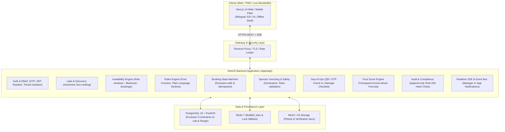
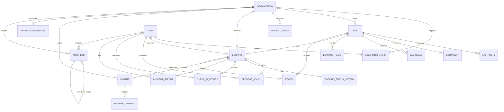
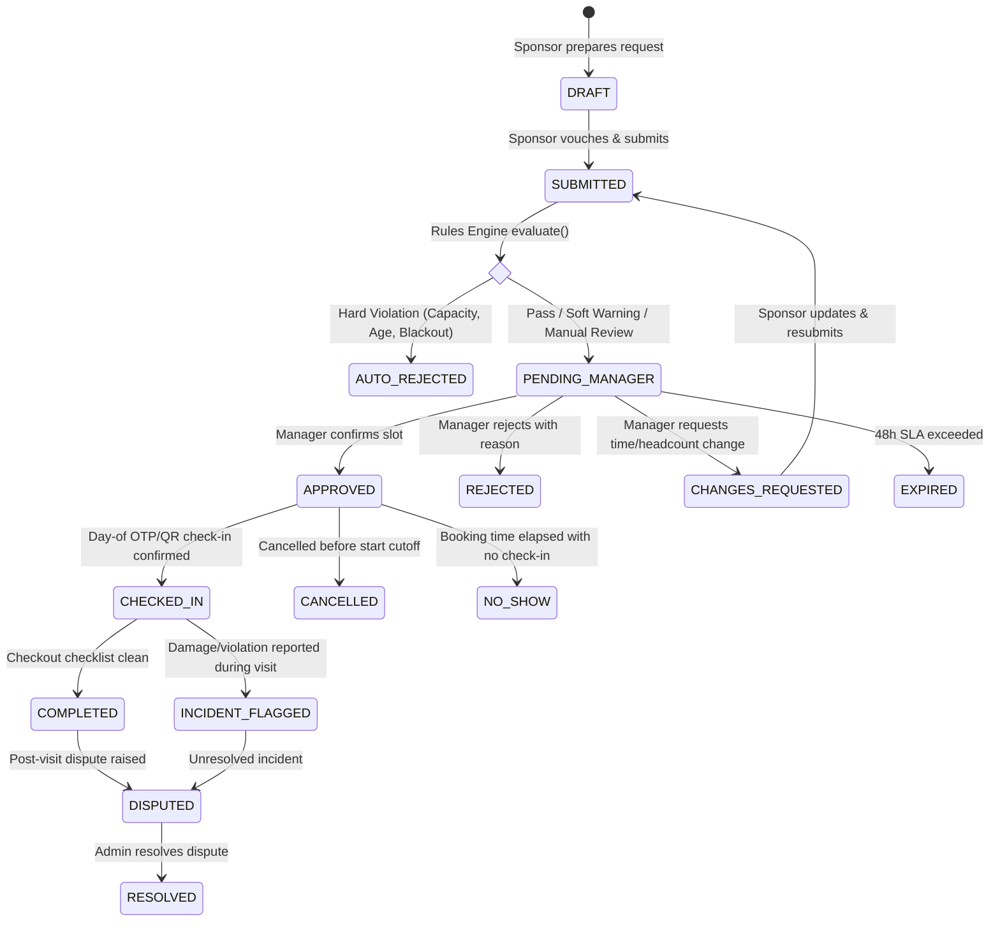
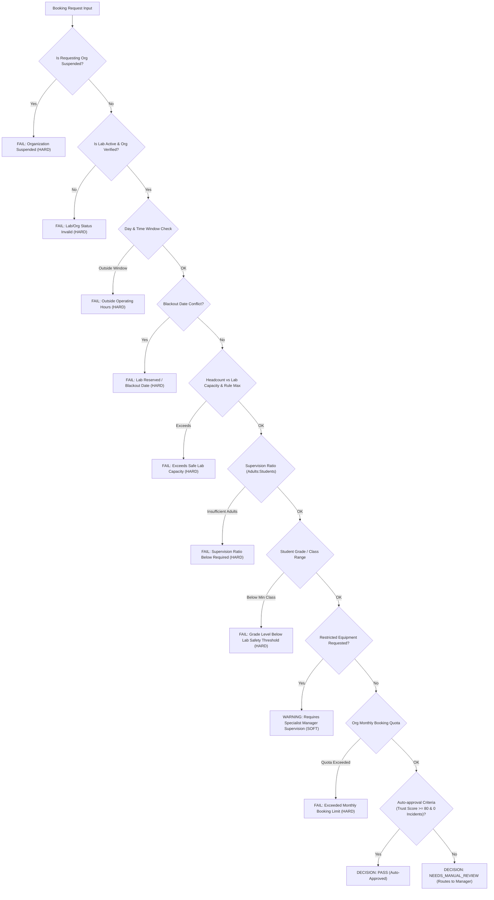

# LabShare Architecture & Technical Specification

> **Platform Mission:** "Connecting idle school labs with rural communities and under-resourced schools."

---

## 1. System Architecture Overview

---

## 2. Entity-Relationship Diagram (Database Architecture)

---

## 3. Booking State Machine

All transitions strictly enforced in domain layer and backed by optimistic locking (`version` column) and PostgreSQL exclusion constraints (`btree_gist`).

---

## 4. Rules Engine Architecture

The Rules Engine is a deterministic pure function:
`evaluate(request, lab, rules, group, sponsor, org) -> RulesEvaluationResult`

---

## 5. Security Model & IDOR Prevention

1. **Organization Scoping:** Every user membership binds the authenticated identity to a specific `organization_id` and `role`.
2. **Repository-Level Tenancy Filter:** All queries verify tenancy. A manager of School A cannot query, approve, or mutate bookings or labs belonging to School B.
3. **Audit Ledger Immutability:**
   - Every sensitive event produces an immutable audit record.
   - Hash chaining: `hash = SHA256(prev_hash + sequence + action + actor_id + entity_id + timestamp + payload_hash)`.
   - PostgreSQL trigger throws exception on any attempt to `UPDATE` or `DELETE` rows in `audit_logs`.
   - Admin endpoint `/api/v1/admin/audit/verify` scans and validates unbroken hash chain integrity.
4. **Minor Safety & Zero PII Storage:**
   - No individual student names, photos, or personal identification records are ever stored in the database.
   - Only aggregate headcounts, grade/standard brackets (e.g. Class 6-8), and the verified adult sponsor's legal declaration and contact number are retained.
