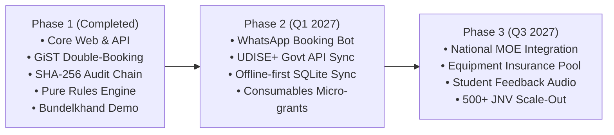

# Honest Limitations & Strategic Product Roadmap

Every production-grade platform must acknowledge real-world operational boundaries and map out clear mitigations.

---

## 1. Current Limitations & Honest Engineering Constraints

| Area | Current Constraint | Real-World Impact | Workaround in Current Build |
| :--- | :--- | :--- | :--- |
| **Institutional Verification** | Manual UDISE & registration review by Platform Admin. | Onboarding new schools takes up to 24–48 hours for document review. | Admin queue with 1-click verify/reject; demo mode pre-verifies all pilot institutions. |
| **Physical Damage Liability** | Host schools carry baseline risk if equipment is cracked or broken during practicals. | Hesitation from conservative lab in-charges to list high-end glass spectrographs. | Checkout damage checklist logs incidents immediately; disputes tribunal adjudicates claims; trust score penalties enforce discipline. |
| **Connectivity at Gate** | Remote rural school gates may experience dead zones during arrival check-in. | Inability to reach internet server to verify live QR codes. | Dual authentication: 6-digit offline SMS OTP code can be recorded manually and reconciled when back in range. |
| **Transportation** | LabShare matches labs within 15 km, but rural students still require bus/auto transport. | Travel cost can be a barrier for remote village students. | Partnered with local educational NGOs (e.g. Bundelkhand Shiksha Samiti) that provide shared student shuttle services. |

---

## 2. Strategic Roadmap

### Phase 2: High-Adoption Enhancements (Q1 2027)
1. **WhatsApp Interactive Booking Bot:**
   - Allow rural teachers to check availability and confirm slots via conversational WhatsApp messages (`"Book JNV Physics lab this Friday 3 PM"`), eliminating smartphone app installation hurdles.
2. **Direct UDISE+ Automated Sync:**
   - Integrate with the Ministry of Education's UDISE+ API to automatically authenticate school accreditation numbers, principal names, and verified physical addresses in seconds.
3. **Consumable Replenishment Micro-Grants:**
   - Automatically route CSR micro-donations (e.g., ₹20 per student-hour) directly to host school lab maintenance funds for chemical reagents, slide replacements, and printer toner.

### Phase 3: National Institutional Scale (Q3 2027)
1. **NEP 2020 "School Complexes" National Rollout:**
   - Partner with the Department of School Education to roll out LabShare across all **661 Jawahar Navodaya Vidyalayas** and **1,250+ Kendriya Vidyalayas** nationwide as the official digital infrastructure for School Complex Resource Sharing.
2. **Community Lab Insurance Partnership:**
   - Partner with public general insurance providers (e.g., New India Assurance) to provide micro-insurance coverage (₹2/student/session) protecting host schools against equipment damage claims.
